# Mobility and Mechanical Design

In this README, we detail the 3D-printed chassis architecture, rear drivetrain coupling, front Ackermann steering geometry, and mechanical design choices behind our vehicle.

## Contents

- [Full Chassis CAD](#full-chassis-cad)
- [Subsystems](#subsystems)
  - [1. Chassis Architecture](#1-chassis-architecture)
  - [2. Rear Drivetrain](#2-rear-drivetrain)
  - [3. Front Ackermann Steering](#3-front-ackermann-steering)
  - [4. Wheel Hubs & Mounting](#4-wheel-hubs--mounting)
- [Fabrication & 3D Printing](#fabrication--3d-printing)
- [Mechanical Challenges](#mechanical-challenges)

## Full Chassis CAD

  
   
  Complete 3D-Printed Chassis Assembly (24 cm × 14 cm × 25 cm) — <a href="chassis-assembly.step">Click here to download the CAD file</a>

  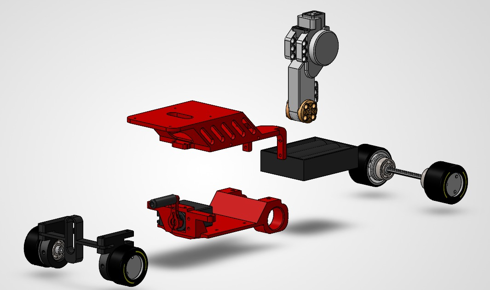
   
  Exploded View of Full Chassis Assembly

## Subsystems

### 1. Chassis Architecture

Our chassis measures **24 cm × 14 cm × 25 cm** (L × W × H) and is split into two main 3D-printed bodies—**top** and **bottom**—joined by four screws (two at the front threading into heat-set inserts on the bottom body, and two at the rear):

- **Top Body:** Holds the 3-slot 18650 battery holder and the Raspberry Pi 4. It features side openings that act as air vents to dissipate battery heat, plus side mounting holes used to attach a crossbar and side mounts for the ToF distance sensors and regulator modules.
- **Bottom Body:** Houses the front steering assembly and the rear drivetrain, keeping heavy mechanical components low to maintain stability through tight corners.

<table>
  <tr>
    <td align="center" width="33%">
      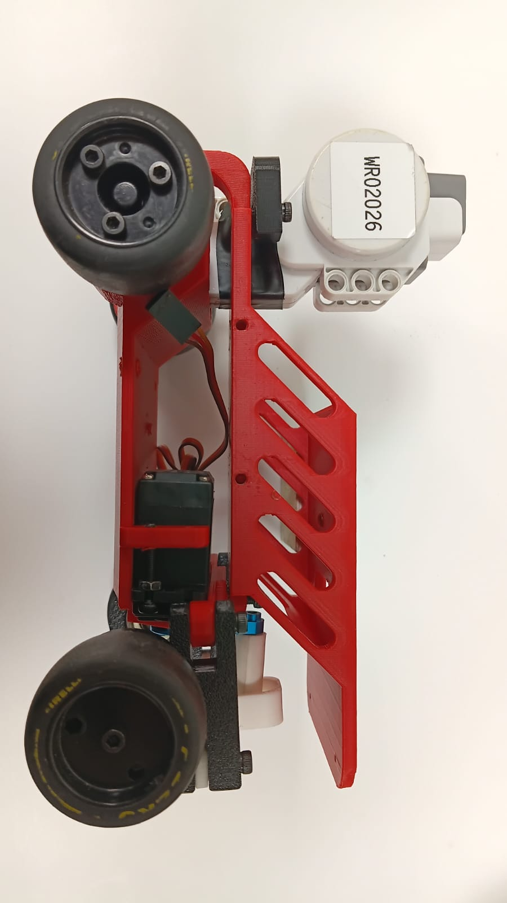 
      Side View
    </td>
    <td align="center" width="33%">
      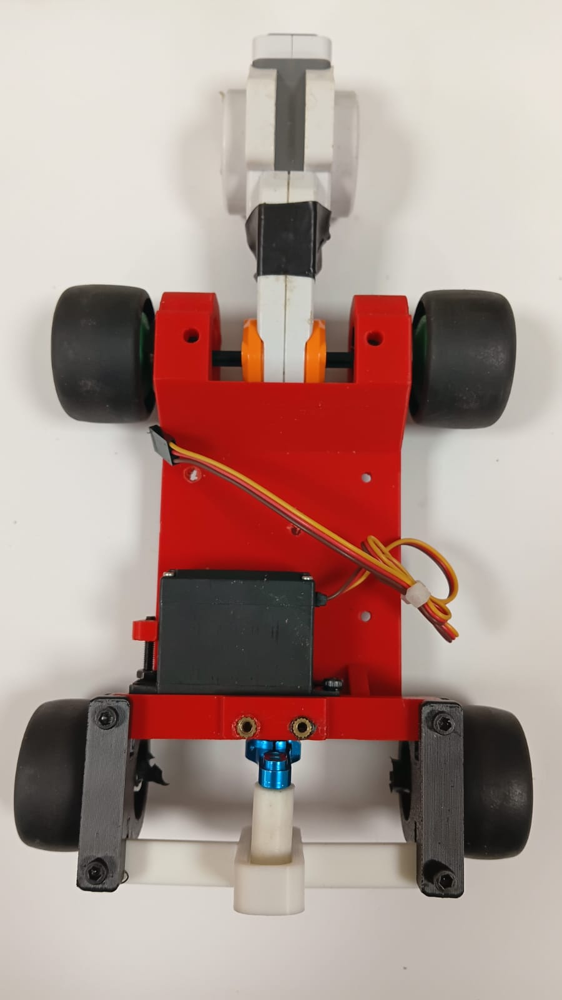 
      Bottom Body (Top View)
    </td>
    <td align="center" width="33%">
      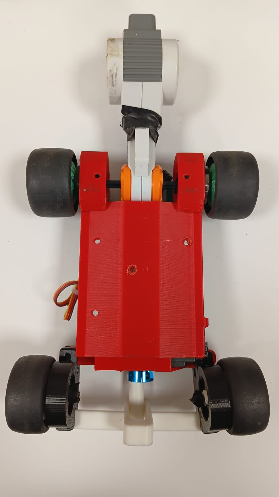 
      Bottom View
    </td>
  </tr>
</table>

### 2. Rear Drivetrain

Rear-wheel propulsion uses a direct-drive layout built around a **LEGO EV3 Large Motor** mounted upright:

- **Bearings & Hubs:** The rear of the bottom chassis body seats four **608ZZ ball bearings** (two on each side). Custom 3D-printed wheel hubs press into these bearings.
- **Axle & Motor Coupling:** A single LEGO axle passes through the upright LEGO EV3 motor output hub and connects both rear wheel hubs together.
- **Motor Retention:** The upper body of the motor fits into an alignment slot in the top chassis body, padded with tape to eliminate mechanical play and keep the motor rigid under acceleration.

  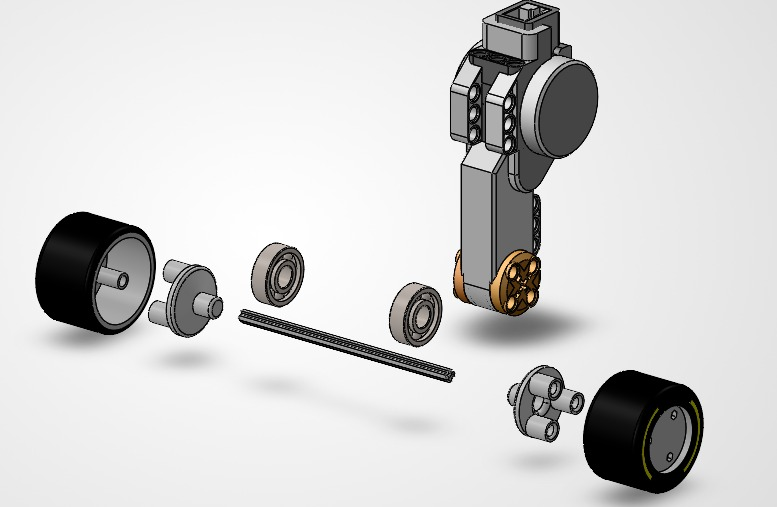
   
  Drivetrain Exploded View (SolidWorks)

<table>
  <tr>
    <td align="center" width="50%">
      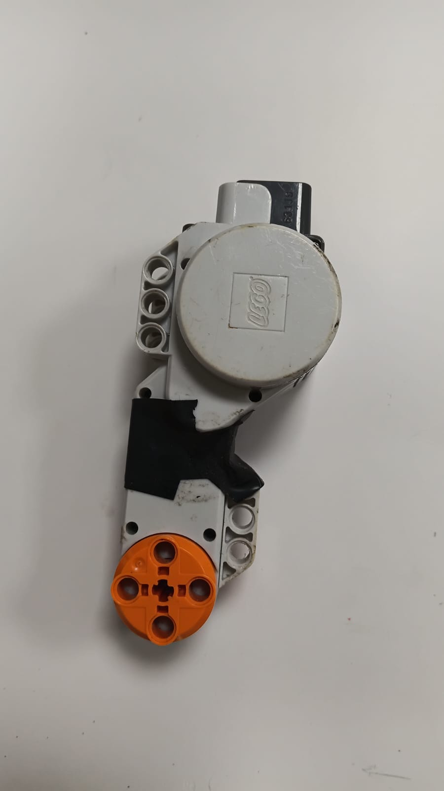 
      LEGO EV3 Motor Placement
    </td>
    <td align="center" width="50%">
      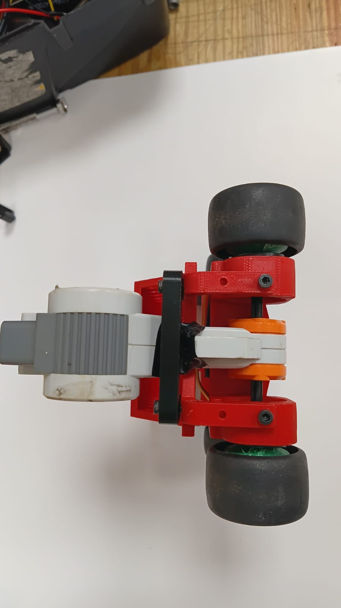 
      Rear View of Drivetrain
    </td>
  </tr>
</table>

### 3. Front Steering System

Front steering is actuated by a horizontally mounted **Hitec HS-485HB** servo equipped with a **25T aluminum servo horn** driving a custom 3D-printed **Scotch yoke linkage**:

- **Scotch Yoke Mechanism:** A pin on the aluminum servo horn rides inside the vertical slot of the T-shaped steering bar, converting the servo's rotational output into smooth, linear left-to-right translation.
- **Steering Knuckles & Pivots:** The outer ends of the steering bar couple into clevis slots on the left and right 3D-printed steering knuckles, pivoting them symmetrically around vertical kingpin fasteners mounted to the lower chassis body.
- **Bearings & Wheel Hubs:** Each steering knuckle houses a **608ZZ ball bearing**, and a custom 3D-printed wheel hub presses directly into the inner race of the bearing so the front RC wheels rotate freely with minimal rolling resistance.

  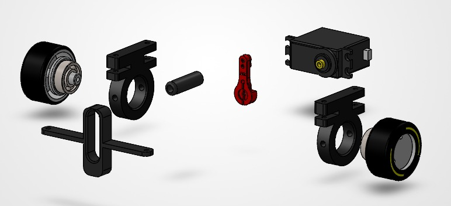
   
  Front Steering Exploded View (SolidWorks)

<table>
  <tr>
    <td align="center" width="33%">
      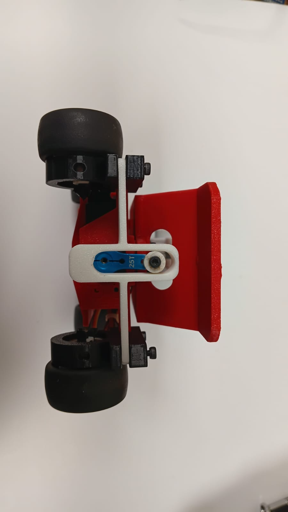 
      Front View (Mounted)
    </td>
    <td align="center" width="33%">
      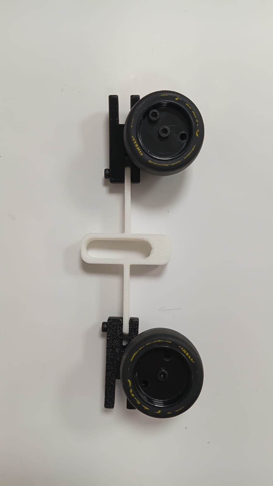 
      Front View (Dismounted)
    </td>
    <td align="center" width="33%">
      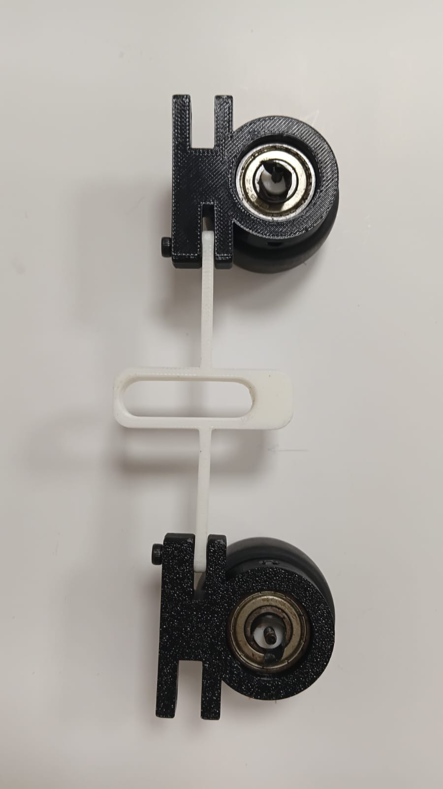 
      Back View (Dismounted)
    </td>
  </tr>
</table>

### 4. Wheel Hubs & Mounting

## Fabrication & 3D Printing

## Mechanical Challenges