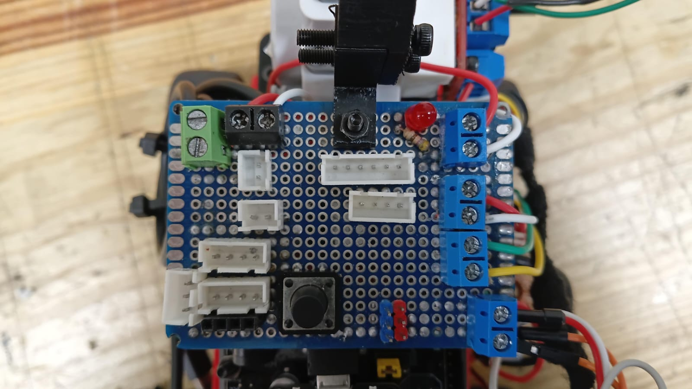
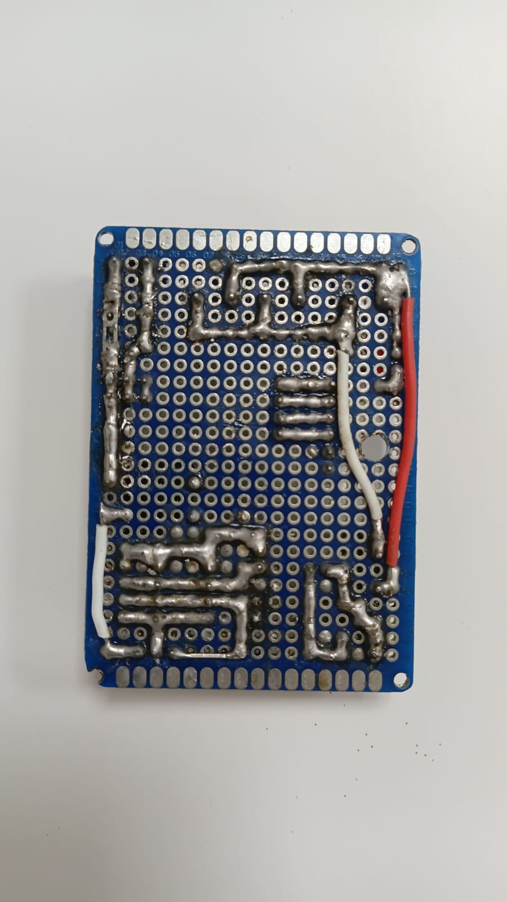
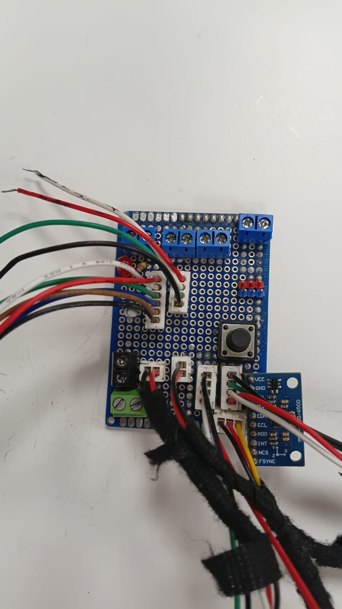
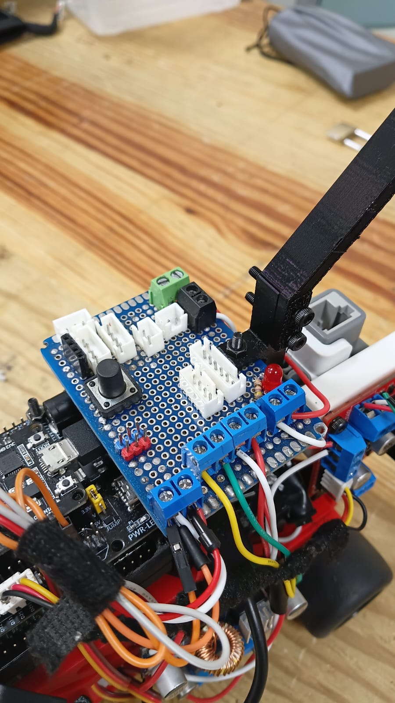
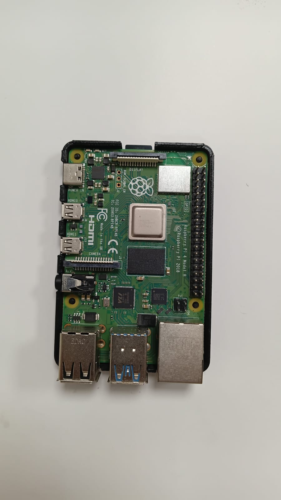
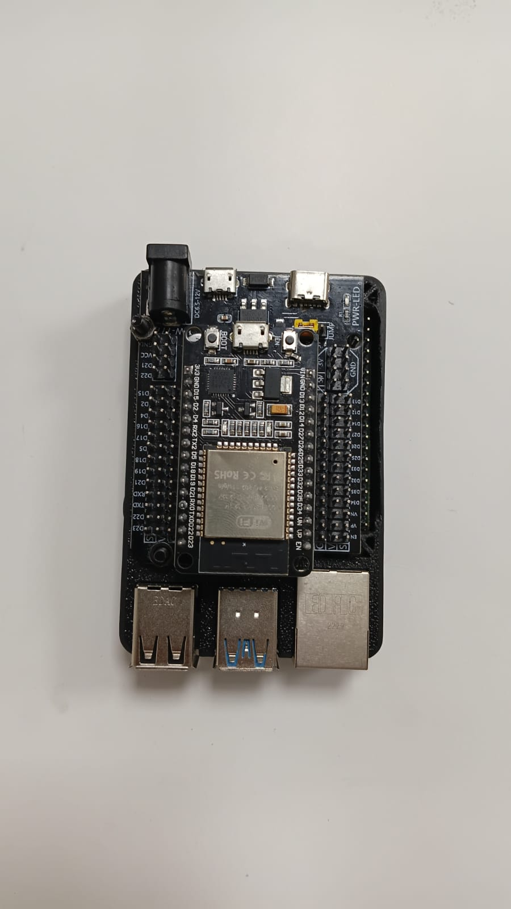

# Power and Sensor Architecture

In this README, we will go into detail on the electrical design, circuit diagram, modules, and electronic choices behind our vehicle.

## Contents

- [Schematic](#schematic)
- [Perfboard Assembly](#perfboard-assembly)
  - [Perfboard Circuit Diagram](#perfboard-circuit-diagram)
  - [Assembly Process](#assembly-process)
  - [Challenges](#challenges)
- [Subsystems](#subsystems)
  - [1. Computing](#1-computing)
  - [2. Power Regulation](#2-power-regulation)
  - [3. Power Regulation Modules](#3-power-regulation-modules)
  - [4. Motor Driver](#4-motor-driver)
  - [5. Sensors](#5-sensors)

## Schematic

  
   
  Complete Electrical Schematic Diagram — <a href="schematic.kicad_sch">Click here to download the KiCad file</a>

## Perfboard Assembly

To keep wiring compact and prevent loose connections from track vibrations, we soldered a custom perfboard to distribute power from the 3S 18650 battery pack to our three buck converters, motor driver, and ESP32 shield with a clean common ground.

### Perfboard Circuit Diagram

  
   
  Perfboard Wiring and Trace Layout — <a href="perfboard.kicad_pcb">Click here to download the KiCad file</a>

<table>
  <tr>
    <td align="center" width="50%">
       
      Top View
    </td>
    <td align="center" width="50%">
       
      Bottom View
    </td>
  </tr>
  <tr>
    <td align="center" width="50%">
       
      Perfboard Fully Wired
    </td>
    <td align="center" width="50%">
       
      Installed in Robot (Isometric)
    </td>
  </tr>
</table>

### Assembly Process

1. **Layout & Placement:** Arranged power input terminals, voltage rail buses, and header pins on the perfboard to keep high-current battery lines separate from low-voltage signal traces.
2. **Power & Ground Buses:** Soldered solid tinned wire rails along the underside to form a unified common ground plane and distribute the raw 3S battery voltage to each buck converter input.
3. **Header & Connector Integration:** Added male/female pin headers and screw terminals so the buck converters, L298N driver, and ESP32 shield plug in cleanly without permanent hard-wired splices.
4. **Continuity & Voltage Verification:** Tested every rail with a multimeter for short circuits before connecting loads, then calibrated each buck converter potentiometer to its target output voltage.

### Challenges

- **Tight Trace Spacing:** Routing multiple power rails and common ground paths on a compact perfboard required careful planning to avoid solder bridges between adjacent pads.
- **Regulator Accessibility:** Initially, the three buck converters were housed inside a bottom cavity of the chassis, making live voltage probing and potentiometer adjustments difficult without disassembling the frame. Relocating the regulators to the exterior side of the chassis solved this and made field calibration immediate.

## Subsystems

### 1. Computing

We divided the computing workload between the **Raspberry Pi 4** and the **ESP32**. The Raspberry Pi 4 handles high-level decision-making and camera processing, while the ESP32 manages real-time actuator control. Both boards communicate directly via a USB serial connection. By running the Arduino IDE directly on the Raspberry Pi, we can edit and upload firmware to the ESP32 on the robot without needing to disconnect it or plug it into an external laptop.

<table>
  <tr>
    <td align="center" width="50%">
       
      Raspberry Pi 4 (SBC)
    </td>
    <td align="center" width="50%">
       
      ESP32 + Expansion Shield (SBM)
    </td>
  </tr>
</table>

#### ESP32 Pinout Mapping

| Peripheral / Module | Signal / Pin | ESP32 GPIO | Notes |
| :--- | :--- | :--- | :--- |
| **L298N Motor Driver** | `ENA` (Speed) | `GPIO X27` | PWM output for drive motor speed |
| **L298N Motor Driver** | `IN1` | `GPIO 25` | Forward/reverse logic control |
| **L298N Motor Driver** | `IN2` | `GPIO 26` | Forward/reverse logic control |
| **Hitec HS-485HB Servo** | `PWM` | `GPIO 18` | 50 Hz steering control signal |
| **MPU-9250 IMU** | `SDA` | `GPIO 21` | I2C data line (3.3 V) |
| **MPU-9250 IMU** | `SCL` | `GPIO 22` | I2C clock line (3.3 V) |
| **ToF Distance Sensors** | `SDA` / `SCL` | `GPIO 21` / `GPIO 22` | Shared I2C bus (3.3 V) |
| **ToF Distance Sensor 1** | `XSHUT` | `GPIO 16` | Sensor 1 shutdown / I2C address assignment |
| **ToF Distance Sensor 2** | `XSHUT` | `GPIO `7` | Sensor 2 shutdown / I2C address assignment |
| **Push Button** | `Signal` | `GPIO 13` | Start / mode trigger input |
| **Raspberry Pi 4 (SBC)** | `USB Serial` | `UART0 (Micro-USB)` | High-level commands and telemetry |

### 2. Power Regulation

We divided voltage regulation into three isolated buck converter modules:
- **Compute Rail:** Supplies 5.1 V to the Raspberry Pi 4, which in turn powers the ESP32 via USB and provides 3.3 V to the MPU-9250 IMU and ToF sensors.
- **Drivetrain Rail:** Regulates voltage for the L298N motor driver (tuned to ≈ 10.8 V–11.0 V at the input to compensate for the L298N internal drop and deliver 9.0 V to the LEGO EV3 drive motor).
- **Steering Rail:** Supplies 5.5 V dedicated to the steering servo.

### 3. Power Regulation Modules

#### XL4015 DC-DC Buck Converter (x2)

We selected two **XL4015** step-down modules to independently power the **Raspberry Pi 4 (5.1 V)** and the **Hitec HS-485HB steering servo (5.5 V)**. Its 5 A current rating provides plenty of headroom to handle CPU/camera load spikes on the Pi and sudden stall currents on the steering servo without voltage dips, while its high switching efficiency keeps heat low on the compact chassis.

   
  XL4015 5 A Step-Down Converter

| Specification | Value |
| :--- | :--- |
| **Input Voltage** | 4 V – 38 V DC |
| **Output Voltage** | 1.25 V – 36 V DC (Adjustable) |
| **Max Output Current** | 5.0 A (4.0 A continuous without heatsink) |
| **Switching Frequency** | 180 kHz |
| **Efficiency** | Up to 96% |

---

#### LM2596 DC-DC Buck Converter

We chose the **LM2596** step-down module to regulate voltage from the 3S battery pack down to **9.0 V** for the **L298N motor driver and LEGO EV3 drive motor**. It is compact, reliable, and easily handles the nominal current draw of the drive motor while isolating motor switching noise from the compute and servo rails.

   
  LM2596 3 A Step-Down Converter

| Specification | Value |
| :--- | :--- | 
| **Input Voltage** | 3.2 V – 40 V DC |
| **Output Voltage** | 1.25 V – 35 V DC (Adjustable) |
| **Max Output Current** | 3.0 A |
| **Switching Frequency** | 150 kHz |
| **Efficiency** | Up to 92% |

### 4. Motor Driver

#### L298N Dual H-Bridge Motor Driver

We selected the **L298N** module to drive our rear **LEGO EV3 Large Motor**. It handles continuous currents up to 2 A per channel, integrates easily with PWM speed and direction pins from the ESP32, and includes an onboard heatsink for reliable thermal performance during repeated acceleration and braking. Because the L298N introduces an internal voltage drop of ≈ 1.8 V–2.0 V, we tune the feeding **LM2596** converter to ≈ 10.8 V–11.0 V so the motor receives a full 9.0 V across its terminals.

   
  L298N Dual H-Bridge Driver

| Specification | Value |
| :--- | :--- |
| **Driver Chip** | L298N Dual H-Bridge |
| **Motor Supply Voltage** | 5 V – 35 V DC |
| **Max Continuous Current** | 2.0 A per channel |
| **Logic Voltage** | 5 V (3.3 V PWM compatible) |

---

### 5. Sensors

#### Forward-Facing USB Webcam

Connected directly to the **Raspberry Pi 4 (SBC)** via USB, the webcam captures live track frames for lane boundary detection, wall distance estimation, and red/green traffic sign recognition using OpenCV.

#### MPU-9250 9-Axis IMU

Powered at **3.3 V** and connected to the **ESP32 (SBM)** via I2C, the MPU-9250 provides real-time yaw angle and angular velocity feedback to keep straight-line tracking stable and execute accurate 90° turns.

#### Time-of-Flight (ToF) Distance Sensors

Powered at **3.3 V** over I2C, our ToF sensors provide fast, short-range proximity measurements to assist with wall clearance and parallel parking alignment.

<table>
  <tr>
    <td align="center" width="33%">
       
      USB Webcam
    </td>
    <td align="center" width="33%">
       
      MPU-9250 9-Axis IMU
    </td>
    <td align="center" width="33%">
       
      ToF Distance Sensor
    </td>
  </tr>
</table>