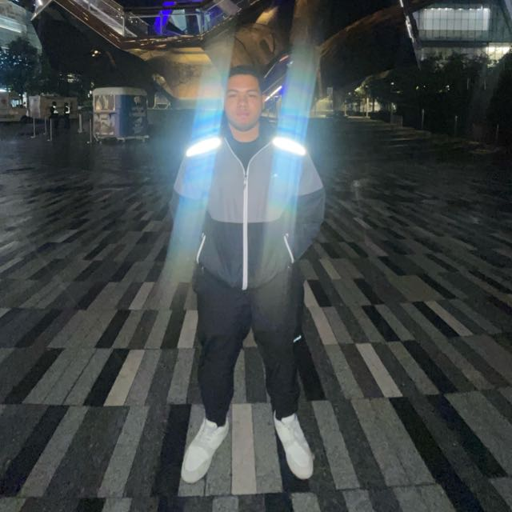

# WRO 2026 Future Engineers — Team PlugAndPlayers

## Introduction

We are **Team PlugAndPlayers** from **Santo Domingo, Dominican Republic**, competing in the **2026 WRO Future Engineers** category (Collegiate division). Both of us are **Mechatronics Engineering** students at **Pontificia Universidad Católica Madre y Maestra (PUCMM)**. We participated in the 2025 WRO season on different teams, and this year we joined forces to combine our strengths and give our best 😎.

We are actively documenting our entire engineering process in this repository—from mechanical design and custom PCB schematics to autonomous control software—so that judges and fellow robotics teams can follow our progress and reproduce our vehicle.

  
   
  <em>Team PlugAndPlayers — Representing PUCMM in WRO 2026 Future Engineers</em>

## The Team

### Team Members

<table>
  <tr>
    <td width="170" align="center">
      
    </td>
    <td>
      <h3>Ivan (<code>@10xIvanDev</code>)</h3>
      
<strong>Role:</strong> Documentation & Electronics Lead | <strong>Affiliation:</strong> PUCMM (Mechatronics Engineering)

      <ul>
        <li><strong>Background:</strong> Electronics technician focused on embedded systems, circuit design, and robotics hardware integration.</li>
        <li><strong>Fun Fact:</strong> Previously worked as an automotive mechanic.</li>
      </ul>
    </td>
  </tr>
  <tr>
    <td width="170" align="center">
      
    </td>
    <td>
      <h3>Pedro Perez</h3>
      
<strong>Role:</strong> Mechanical & Software Lead | <strong>Affiliation:</strong> PUCMM (Mechatronics Engineering)

      <ul>
        <li><strong>Background:</strong> Experienced in 3D printing, rapid prototyping, and software development.</li>
        <li><strong>Fun Fact:</strong> Enthusiast of Formula 1 and aviation.</li>
      </ul>
    </td>
  </tr>
</table>

### Coach
* **Jesus Ramirez** — Director of Mechanical and Electrical Engineering, Pontificia Universidad Católica Madre y Maestra (PUCMM)
* **Alvaro Zapata** — Team Mentor

### Links to Our Socials
* **GitHub:** https://github.com/10xIvanDev/WRO2026-FE-PlugAndPlayers
  * Complete source code, CAD files, schematics, and engineering documentation
* **YouTube:** [https://www.youtube.com/@PlugAndPlayers]
  * Autonomous test runs, mechanical demos, and competition videos

---

## Abstract

Our solution is an autonomous vehicle powered by a dual-compute architecture combining **Raspberry Pi** boards for high-level navigation, computer vision, and state-machine logic with **ESP32** microcontrollers for real-time motor control and sensor interfacing. 

To perceive the track and obey traffic rules, our system focuses heavily on **camera and video processing** supported by complementary **onboard sensors** for spatial awareness, wall tracking, and orientation. Together, this hardware and software stack drives our custom chassis to execute tight turns, reliable obstacle avoidance, and repeatable parking maneuvers.
---

## Table of Contents

1. [Our Journey & Engineering Process](#1-our-journey--engineering-process)
2. [Ideas & Systems Thinking Principles](#2-ideas--systems-thinking-principles)
3. [Mobility & Mechanical Design](#3-mobility--mechanical-design)
4. [Power & Sensor Architecture](#4-power--sensor-architecture)
5. [Software Architecture & Obstacle Strategy](#5-software-architecture--obstacle-strategy)
6. [Testing, Measurements & Calibration](#6-testing-measurements--calibration)
7. [Repository Structure & Reproducibility](#7-repository-structure--reproducibility)
8. [Videos & Media](#8-videos--media)
9. [Special Thanks](#9-special-thanks)

---

## 9. Special Thanks

Special thanks to **Jesus Ramirez**, **Alvaro Zapata**, and the **PUCMM Mechanical and Electrical Engineering Department** for their technical mentorship, guidance, and support throughout our build.