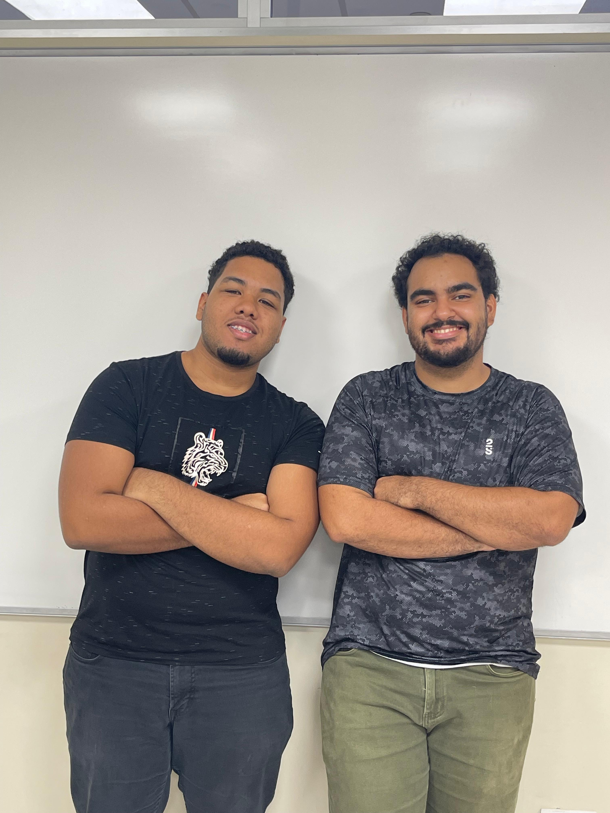
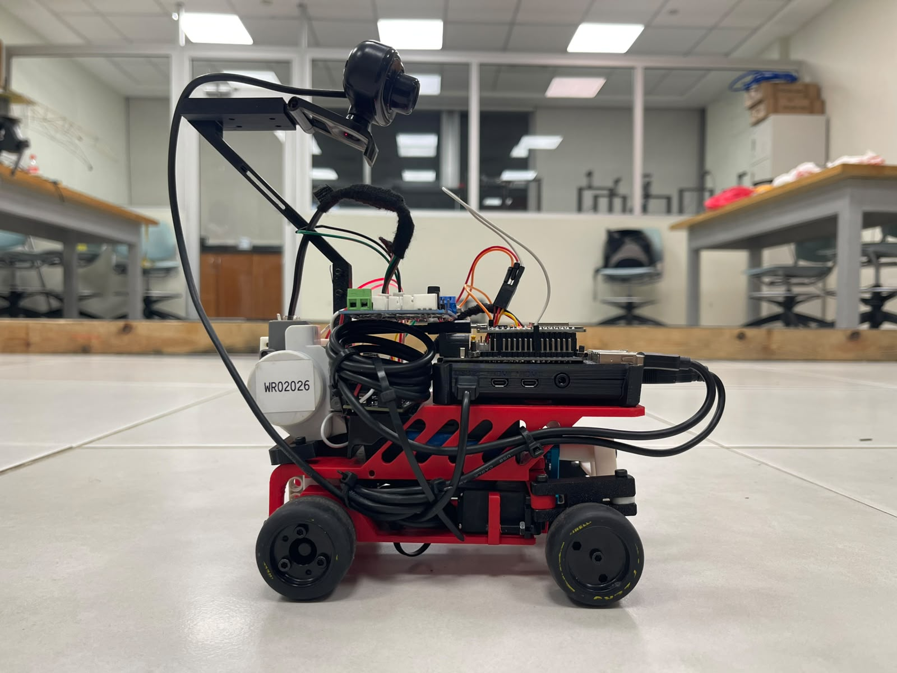

# WRO 2026 Future Engineers — Team PlugAndPlayers

  

## Contents

- [Introduction](#introduction)
  - [The Team](#the-team)
  - [Engineering Journal](#engineering-journal)
  - [Our Overview of the Challenges](#our-overview-of-the-challenges)
- [The Robot](#the-robot)
  - [Overview](#overview)
  - [First Design](#first-design)
  - [Design Decisions](#design-decisions)
  - [Final Design](#final-design)
- [Prices](#prices)
- [Power](#power)
  - [Power Budget](#power-budget)
  - [Power Challenges](#power-challenges)
  - [Power Architecture](#power-architecture)
  - [Key Specs](#key-specs)
- [Systems](#systems)
  - [Mechanical System](#mechanical-system)
    - [Motor](#motor)
    - [Servo Motor](#servo-motor)
    - [Wheels](#wheels)
  - [Electrical & Sensor System](#electrical--sensor-system)
    - [Regulator](#regulator)
    - [Circuit Diagram](#circuit-diagram)
- [Software](#software)
- [Testing](#testing)
  - [Performance Videos](#performance-videos)
    - [Open Challenge](#open-challenge)
    - [Obstacle Challenge](#obstacle-challenge)
- [Special Thanks](#special-thanks)

---

## Introduction

We are **Team PlugAndPlayers** from **Santo Domingo, Dominican Republic**, competing in the **2026 WRO Future Engineers** category (Collegiate division). Both of us are **Mechatronics Engineering** students at **Pontificia Universidad Católica Madre y Maestra (PUCMM)**. We participated in the 2025 WRO season on different teams, and this year we joined forces to combine our strengths and give our best 😎.

We are actively documenting our entire engineering process in this repository—from mechanical design and custom PCB schematics to autonomous control software—so that judges and fellow robotics teams can follow our progress and reproduce our vehicle.

  
   
  <em>Team PlugAndPlayers — Representing PUCMM in WRO 2026 Future Engineers</em>

### Abstract

Our solution is an autonomous vehicle powered by a dual-compute architecture combining **Raspberry Pi** boards for high-level navigation, computer vision, and state-machine logic with **ESP32** microcontrollers for real-time motor control and actuation. 

To perceive the track, detect walls, and obey traffic rules, our system relies purely on **camera and video processing**. Together, this vision-driven software stack and custom hardware chassis execute tight turns, reliable obstacle avoidance, and repeatable parking maneuvers.

### The Team

#### Team Members

<table>
  <tr>
    <td width="170" align="center">
      
    </td>
    <td>
      <h3>Ivan Saint-Hilaire(<code>@10xIvanDev</code>)</h3>
      
<strong>Role:</strong> Documentation & Electronics Lead | <strong>Affiliation:</strong> PUCMM (Mechatronics Engineering)

      <ul>
        <li><strong>Background:</strong> Electronics technician focused on embedded systems, circuit design, and robotics hardware integration.</li>
        <li><strong>Fun Fact:</strong> Previously worked as an automotive mechanic.</li>
      </ul>
    </td>
  </tr>
  <tr>
    <td width="170" align="center">
      
    </td>
    <td>
      <h3>Pedro Perez(<code>@pjpw-gif</code>)</h3>
      
<strong>Role:</strong> Mechanical & Software Lead | <strong>Affiliation:</strong> PUCMM (Mechatronics Engineering)

      <ul>
        <li><strong>Background:</strong> Experienced in 3D printing, rapid prototyping, and software development.</li>
        <li><strong>Fun Fact:</strong> Enthusiast of Formula 1 and aviation.</li>
      </ul>
    </td>
  </tr>
</table>

#### Coach & Mentors
- **Jesus Ramirez** — Director of Mechanical and Electrical Engineering, Pontificia Universidad Católica Madre y Maestra (PUCMM)
- **Alvaro Zapata** — Team Mentor

#### Links to Our Socials
- **GitHub:** https://github.com/10xIvanDev/WRO2026-FE-PlugAndPlayers
  - Complete source code, CAD files, schematics, and engineering documentation
- **YouTube:** https://www.youtube.com/@PlugAndPlayers
  - Autonomous test runs, mechanical demos, and competition videos

### Engineering Journal

An **Engineering Journal** is a structured, chronological record of a team's design evolution—capturing not just the final robot, but the reasoning, trade-offs, test data, and iterations that shaped every subsystem along the way. Rather than serving as a simple assembly manual, it demonstrates the engineering mindset behind how problems were diagnosed, validated, and resolved.

When building our Engineering Journal and organizing this repository, we prioritized four core principles:

* **Readability & Clarity:** Structuring sections logically with clear schematics, visual diagrams, and concise tables so judges and fellow engineers can quickly grasp our system architecture without sifting through unorganized notes.
* **Full Reproducibility:** Providing complete CAD models, Bills of Materials (BOM), wiring diagrams, power budgets, and modular source code so another team could replicate our vehicle from scratch.
* **Evidence-Based Decisions:** Backing every major design choice ("why we chose X over Y") with quantitative bench tests, calibration logs, and real-world track performance rather than guesswork.
* **Traceable Iteration:** Documenting early prototypes, mechanical and software failures, and the specific refinements made between versions to show continuous improvement across the season.

**Access our complete Engineering Journal PDF here:** [`Engineering-Journal/Engineering-Journal.pdf`](Engineering-Journal/Engineering-Journal.pdf)

---

### Our Overview of the Challenges

At its core, the **WRO Future Engineers** category challenges teams to design, build, and program a fully autonomous miniature vehicle capable of navigating a dynamic, randomized track—from high-speed open-lane driving in the **Open Challenge** to real-time traffic-sign recognition, obstacle avoidance, and precision parallel parking in the **Obstacle Challenge**. Rather than rewarding a rigid, pre-programmed sequence of movements, the competition demands genuine autonomy, adaptability, and system reliability.

Succeeding in these challenges tests a wide spectrum of multidisciplinary engineering skills:
* **Mechanical & Mobility Engineering:** Balancing drivetrain torque, top speed, chassis weight distribution, and Ackermann steering geometry to achieve tight turning radii and repeatable trajectory tracking.
* **Electronics & Power Systems:** Designing clean power distribution, managing voltage regulation and efficiency losses, and isolating compute electronics from motor noise.
* **Computer Vision & Embedded Control:** Processing real-time camera feeds under variable lighting conditions, fusing sensor feedback, and executing low-latency motor and servo control across our dual-microcontroller architecture (Raspberry Pi + ESP32).
* **Systems Integration & Debugging:** Ensuring mechanical, electrical, and software subsystems operate seamlessly as a unified machine under strict competition time constraints.

Throughout this season, our attitude toward engineering problems is rooted in **systematic root-cause analysis and rapid iteration**. When a test run fails—whether due to mechanical slip, voltage drop, or camera glare—we treat it as diagnostic data: we isolate the variable, measure the behavior, implement a targeted fix, and validate the improvement on the track.

Beyond competing, our primary goal in this process is to bridge our academic foundation in Mechatronics Engineering at PUCMM with hands-on, end-to-end product development—mastering collaborative Git workflows, embedded Linux and real-time firmware integration, hardware-software co-design, and disciplined engineering documentation.

---

## The Robot

### Overview

Our autonomous vehicle was engineered around a **compact, lightweight, and functional design philosophy**. Rather than building an overly bulky or complex chassis, we drew inspiration from top-performing repositories of previous WRO Future Engineers seasons—prioritizing mechanical simplicity, low rotational inertia, easy hardware access, and clean component integration.

Measuring **$24\text{ cm} \times 14\text{ cm} \times 25\text{ cm}$** ($L \times W \times H$), the robot sits well within the official WRO maximum footprint ($30\text{ cm} \times 20\text{ cm} \times 30\text{ cm}$). Keeping the footprint narrow ($14\text{ cm}$ wide) and compact ($24\text{ cm}$ long) gives the vehicle generous lateral margin when navigating tight $90^\circ$ corners, weaving between red and green traffic signs, and executing parallel parking maneuvers without clipping track walls.

  
   
  <em>Isometric view of our Robot</em>

#### Vehicle Specifications & Dimensional Compliance

| Parameter | Value | WRO 2026 Limit / Notes |
| :--- | :--- | :--- |
| **Overall Length (L)** | $24.0\text{ cm}$ ($240\text{ mm}$) | $\le 30.0\text{ cm}$ ($6.0\text{ cm}$ safety margin) |
| **Overall Width (W)** | $14.0\text{ cm}$ ($140\text{ mm}$) | $\le 20.0\text{ cm}$ ($6.0\text{ cm}$ safety margin) |
| **Overall Height (H)** | $25.0\text{ cm}$ ($250\text{ mm}$) | $\le 30.0\text{ cm}$ (elevated camera vantage point) |
| **Drivetrain Layout** | Rear-Wheel Drive (RWD) | Single DC motor + front Ackermann servo steering |
| **Compute Architecture** | Raspberry Pi + ESP32 | Dual-controller split (Vision/FSM + Real-time Actuation) |
| **Primary Perception** | Forward-Facing Camera | Pure computer-vision track & traffic sign detection |

#### Multi-Angle Vehicle Views

<table>
  <tr>
    <td align="center" width="50%">
       
      <em>Front View</em>
    </td>
    <td align="center" width="50%">
       
      <em>Back View</em>
    </td>
  </tr>
  <tr>
    <td align="center" width="50%">
       
      <em>Left Side View</em>
    </td>
    <td align="center" width="50%">
       
      <em>Right Side View</em>
    </td>
  </tr>
</table>

### First Design

### Design Decisions

### Final Design

---

## Prices

---

## Power

### Power Budget

To size our power distribution system and verify safe operating margins under both normal cruising and simultaneous actuator stall conditions, we calculated the nominal and peak power draw of every onboard load:

| Component | Supply Rail | Nominal Current | Peak / Stall Current | Nominal Power | Peak Power |
| :--- | :---: | :---: | :---: | :---: | :---: |
| **Raspberry Pi 4 + Camera** | 5.0 V | 1.20 A | 2.50 A | 6.00 W | 12.50 W |
| **ESP32 + MPU-9250 IMU** (via Pi) | 5.0 V / 3.3 V | 0.25 A | 0.50 A | 1.25 W | 2.50 W |
| **LEGO EV3 Large Motor** (via L298N) | 9.0 V | 0.60 A | 1.80 A | 5.40 W | 16.20 W |
| **Steering Servo Motor** | 5.0 V–6.0 V | 0.30 A | 1.20 A | 1.80 W | 7.20 W |
| **Total System Load** | — | **2.35 A** | **6.00 A** | **14.45 W** | **38.40 W** |

> **Note:** Because the L298N H-bridge introduces an internal bipolar transistor drop of ≈ 1.8 V–2.0 V, the XL4015 buck converter is tuned to ≈ 10.8 V–11.0 V at the L298N input so the LEGO EV3 motor receives a full 9.0 V across its terminals under load.

---

### Power Challenges

Running a single-board computer (Raspberry Pi 4) alongside inductive actuators (LEGO EV3 DC motor and steering servo) on a compact mobile chassis introduces three critical electrical failure modes that we explicitly designed against:

* **Raspberry Pi Under-Voltage Brownouts:** The Raspberry Pi 4 triggers CPU throttling or sudden reboots if its 5 V rail dips below 4.65 V during peak vision processing or sudden steering corrections.
* **Inductive Back-EMF & Current Spikes:** Rapid acceleration, braking, or hard steering stalls generate sharp current transients and voltage ripple on the power bus that can corrupt camera frames or reset microcontroller logic.
* **Thermal & Voltage Drop Losses in the L298N:** Unlike modern MOSFET drivers, the L298N drops roughly 2 V internally, reducing motor torque if fed directly from a standard 9 V source unless compensated upstream.

---

### Power Architecture

To eliminate cross-talk between high-current actuators and sensitive digital compute hardware, our electrical architecture splits the main battery bus into **three physically isolated DC-DC buck conversion stages**:

1. **Compute Rail — Dedicated 5 V / 5 A Buck Converter:** Powers the **Raspberry Pi 4** exclusively, which in turn supplies regulated 5 V and 3.3 V to the **ESP32** and **MPU-9250 IMU**. Isolating this rail ensures motor or servo current spikes never pull down the Pi's core voltage.
2. **Drivetrain Rail — XL4015 Step-Down Converter (5 A max) + L298N Driver:** Steps down the battery pack voltage to feed the **L298N H-bridge**, delivering a regulated 9.0 V to the **LEGO EV3 drive motor** with ample current headroom for stall conditions.
3. **Steering Rail — LM2596 Step-Down Converter (3 A max):** Dedicated strictly to the **steering servo motor**, isolating high-frequency PWM switching noise and stall transients from both the compute rail and the main drive motor.
4. **Common Ground & Decoupling:** All three buck converters share a common star-ground reference to guarantee clean UART communication (Raspberry Pi ↔ ESP32) and accurate I2C readings from the MPU-9250, supported by bulk electrolytic decoupling capacitors across the regulator outputs.

---

### Key Specs

* **Battery Pack:** `[Insert Battery Specs — e.g., 3S 11.1 V (12.6 V max) 2200 mAh 30C LiPo — 24.42 Wh]`
* **Regulated Voltage Rails:**
  * **Logic & Vision:** 5.0 V @ 5.0 A max (Dedicated 5 A Buck Regulator)
  * **Drive Motor:** 9.0 V effective @ 5.0 A max (XL4015 Buck + L298N H-Bridge)
  * **Steering Servo:** 5.0 V–6.0 V @ 3.0 A max (LM2596 Buck Regulator)
* **Nominal Operating Power:** ≈ 14.45 W (accounting for ~88% average switching converter efficiency, ≈ 16.4 W drawn from battery)
* **Worst-Case Peak Power:** ≈ 38.40 W (all actuators at stall + full CPU load)
* **Estimated Continuous Runtime:** `[Insert based on battery Wh — e.g., ~70 minutes at nominal load on a 24.4 Wh 3S pack, covering 20+ full competition runs]`

---

## Systems

### Mechanical System

#### Motor

#### Servo Motor

#### Wheels

### Electrical & Sensor System

#### Regulator

#### Circuit Diagram

---

## Software

---

## Testing

### Performance Videos

#### Open Challenge

#### Obstacle Challenge

---

## Special Thanks

Special thanks to **Jesus Ramirez**, **Alvaro Zapata**, and the **PUCMM Mechanical and Electrical Engineering Department** for their technical mentorship, guidance, and support throughout our build.