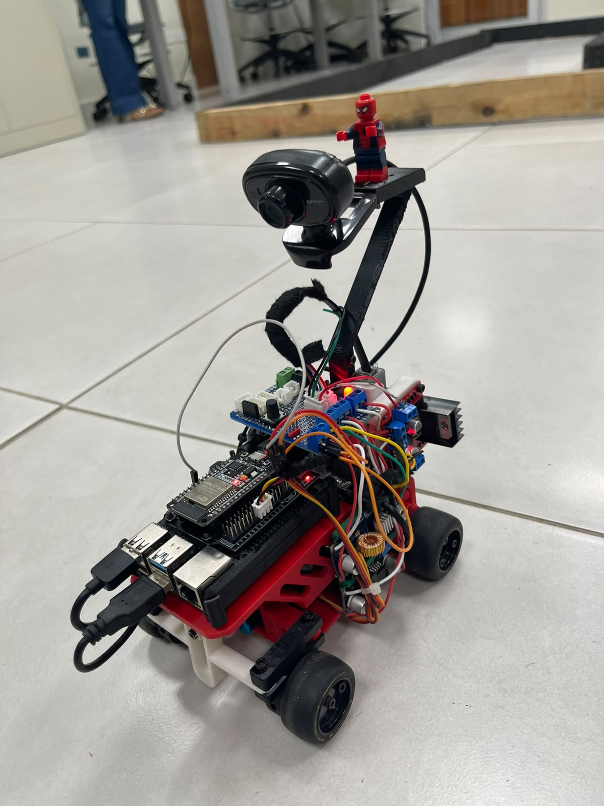
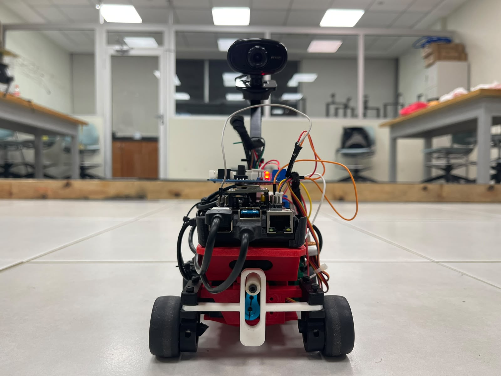
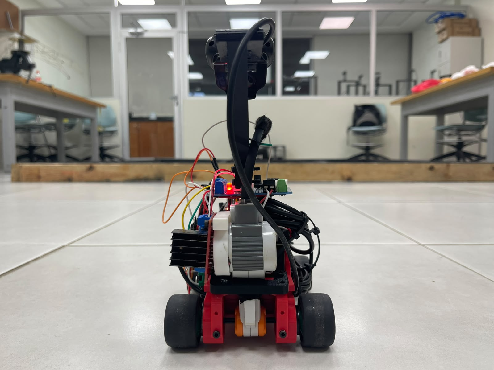
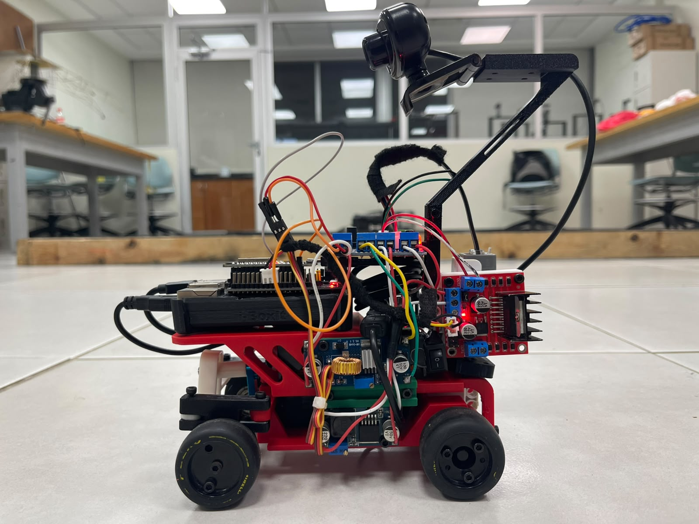
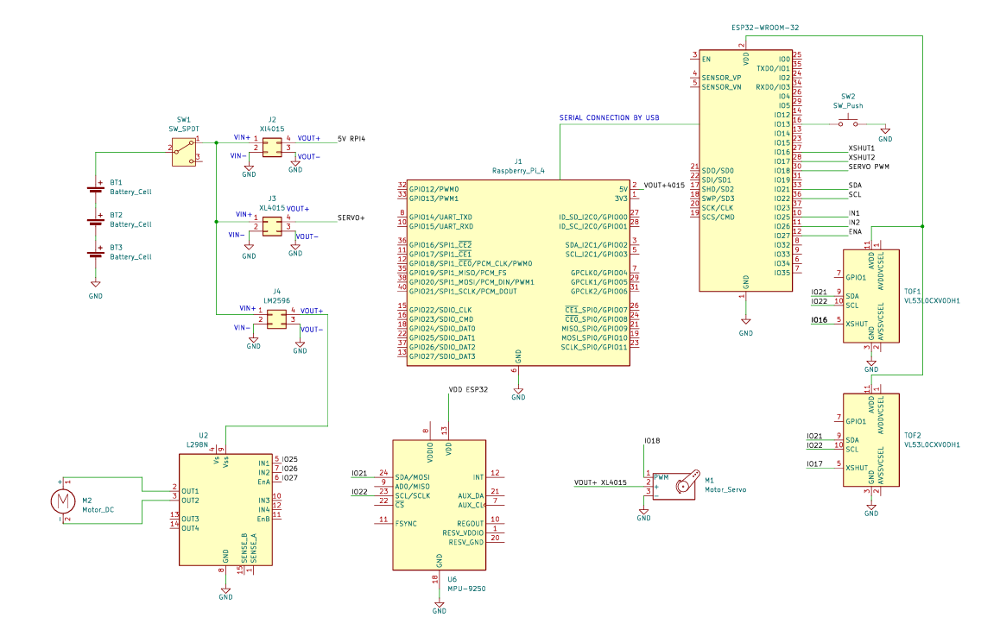

# WRO 2026 Future Engineers — Team PlugAndPlayers

  

## Contents

- [Introduction](#introduction)
  - [The Team](#the-team)
  - [Engineering Journal](#engineering-journal)
  - [Our Overview of the Challenges](#our-overview-of-the-challenges)
- [The Robot](#the-robot)
  - [Overview](#overview)
  - [First Design](#first-design)
  - [Design Decisions](#design-decisions)
  - [Final Design](#final-design)
- [Prices](#prices)
- [Power](#power)
  - [Power Budget](#power-budget)
  - [Power Challenges](#power-challenges)
  - [Power Architecture](#power-architecture)
  - [Key Specs](#key-specs)
- [Systems](#systems)
  - [Mechanical System](#mechanical-system)
    - [Motor](#motor)
    - [Servo Motor](#servo-motor)
    - [Wheels](#wheels)
  - [Electrical & Sensor System](#electrical--sensor-system)
    - [Regulator](#regulator)
    - [Circuit Diagram](#circuit-diagram)
- [Software](#software)
- [Testing](#testing)
  - [Performance Videos](#performance-videos)
    - [Open Challenge](#open-challenge)
    - [Obstacle Challenge](#obstacle-challenge)
- [Special Thanks](#special-thanks)

---

## Introduction

We are **Team PlugAndPlayers** from **Santo Domingo, Dominican Republic**, competing in the **2026 WRO Future Engineers** category (Collegiate division). Both of us are **Mechatronics Engineering** students at **Pontificia Universidad Católica Madre y Maestra (PUCMM)**. We participated in the 2025 WRO season on different teams, and this year we joined forces to combine our strengths and give our best 😎.

We are actively documenting our entire engineering process in this repository—from mechanical design and custom perfboard/PCB electronics to autonomous control software—so that judges and fellow robotics teams can follow our progress and reproduce our vehicle.

  
   
  Team PlugAndPlayers — Representing PUCMM in WRO 2026 Future Engineers

### Abstract

Our solution is an autonomous vehicle powered by a dual-compute architecture combining a **Raspberry Pi 4** for high-level navigation, computer vision, and state-machine logic with an **ESP32** microcontroller for real-time motor control and sensor interfacing.

To perceive the track, detect walls, and obey traffic rules, our system processes live video from a **forward-facing USB webcam** paired with an onboard **MPU-9250 IMU** for orientation and heading stability. Together, this hardware and software stack drives our custom chassis to execute tight turns, reliable obstacle avoidance, and repeatable parking maneuvers.

### The Team

#### Team Members

<table>
  <tr>
    <td width="170" align="center">
      
    </td>
    <td>
      <h3>Ivan Saint-Hilaire (<code>@10xIvanDev</code>)</h3>
      
<strong>Role:</strong> Documentation & Electronics Lead | <strong>Affiliation:</strong> PUCMM (Mechatronics Engineering)

      <ul>
        <li><strong>Background:</strong> Electronics technician focused on embedded systems, circuit design, and robotics hardware integration.</li>
        <li><strong>Fun Fact:</strong> Previously worked as an automotive mechanic.</li>
      </ul>
    </td>
  </tr>
  <tr>
    <td width="170" align="center">
      
    </td>
    <td>
      <h3>Pedro Perez (<code>@pjpw-gif</code>)</h3>
      
<strong>Role:</strong> Mechanical & Software Lead | <strong>Affiliation:</strong> PUCMM (Mechatronics Engineering)

      <ul>
        <li><strong>Background:</strong> Experienced in 3D printing, rapid prototyping, and software development.</li>
        <li><strong>Fun Fact:</strong> Enthusiast of Formula 1 and aviation.</li>
      </ul>
    </td>
  </tr>
</table>

#### Coach & Mentors
- **Jesus Ramirez** — Director of Mechanical and Electrical Engineering, Pontificia Universidad Católica Madre y Maestra (PUCMM)
- **Alvaro Zapata** — Team Mentor

#### Links to Our Socials
- **GitHub:** https://github.com/10xIvanDev/WRO2026-FE-PlugAndPlayers
  - Complete source code, CAD files, schematics, and engineering documentation
- **YouTube:** https://www.youtube.com/@PlugAndPlayers
  - Autonomous test runs, mechanical demos, and competition videos

### Engineering Journal

An **Engineering Journal** is a structured, chronological record of a team's design evolution—capturing not just the final robot, but the reasoning, trade-offs, test data, and iterations that shaped every subsystem along the way. Rather than serving as a simple assembly manual, it demonstrates the engineering mindset behind how problems were diagnosed, validated, and resolved.

When building our Engineering Journal and organizing this repository, we prioritized four core principles:

- **Readability & Clarity:** Structuring sections logically with clear schematics, visual diagrams, and concise tables so judges and fellow engineers can quickly grasp our system architecture without sifting through unorganized notes.
- **Full Reproducibility:** Providing complete CAD models, Bills of Materials (BOM), wiring diagrams, power budgets, and modular source code so another team could replicate our vehicle from scratch.
- **Evidence-Based Decisions:** Backing every major design choice ("why we chose X over Y") with quantitative bench tests, calibration logs, and real-world track performance rather than guesswork.
- **Traceable Iteration:** Documenting early prototypes, mechanical and software failures, and the specific refinements made between versions to show continuous improvement across the season.

**Access our complete Engineering Journal PDF here:** [`Engineering-Journal/Engineering-Journal.pdf`](Engineering-Journal/Engineering-Journal.pdf)

---

### Our Overview of the Challenges

At its core, the **WRO Future Engineers** category challenges teams to design, build, and program a fully autonomous miniature vehicle capable of navigating a dynamic, randomized track—from high-speed open-lane driving in the **Open Challenge** to real-time traffic-sign recognition, obstacle avoidance, and precision parallel parking in the **Obstacle Challenge**. Rather than rewarding a rigid, pre-programmed sequence of movements, the competition demands genuine autonomy, adaptability, and system reliability.

Succeeding in these challenges tests a wide spectrum of multidisciplinary engineering skills:
- **Mechanical & Mobility Engineering:** Balancing drivetrain torque, top speed, chassis weight distribution, and Ackermann steering geometry to achieve tight turning radii and repeatable trajectory tracking.
- **Electronics & Power Systems:** Designing clean power distribution, managing voltage regulation and efficiency losses, and isolating compute electronics from motor noise.
- **Computer Vision & Embedded Control:** Processing real-time camera feeds under variable lighting conditions, fusing IMU orientation feedback, and executing low-latency motor and servo control across our SBC and SBM architecture (Raspberry Pi 4 + ESP32).
- **Systems Integration & Debugging:** Ensuring mechanical, electrical, and software subsystems operate seamlessly as a unified machine under strict competition time constraints.

Throughout this season, our attitude toward engineering problems is rooted in **systematic root-cause analysis and rapid iteration**. When a test run fails—whether due to mechanical slip, voltage drop, or camera glare—we treat it as diagnostic data: we isolate the variable, measure the behavior, implement a targeted fix, and validate the improvement on the track.

Beyond competing, our primary goal in this process is to bridge our academic foundation in Mechatronics Engineering at PUCMM with hands-on, end-to-end product development—mastering collaborative Git workflows, embedded Linux and real-time firmware integration, hardware-software co-design, and disciplined engineering documentation.

---

## The Robot

### Overview

Our autonomous vehicle was engineered around a **compact, lightweight, and functional design philosophy**. Rather than building an overly bulky or complex chassis, we drew inspiration from top-performing repositories of previous WRO Future Engineers seasons—prioritizing mechanical simplicity, low rotational inertia, easy hardware access, and clean component integration.

Measuring **24 cm × 14 cm × 25 cm** (L × W × H), the robot sits well within the official WRO maximum footprint (30 cm × 20 cm × 30 cm). Keeping the footprint narrow (14 cm wide) and compact (24 cm long) gives the vehicle generous lateral margin when navigating tight 90° corners, weaving between red and green traffic signs, and executing parallel parking maneuvers without clipping track walls.

  
   
  Isometric view of our Robot

#### Vehicle Specifications & Dimensional Compliance

| Parameter | Value | WRO 2026 Limit / Notes |
| :--- | :--- | :--- |
| **Overall Length (L)** | 24.0 cm (240 mm) | ≤ 30.0 cm (6.0 cm safety margin) |
| **Overall Width (W)** | 14.0 cm (140 mm) | ≤ 20.0 cm (6.0 cm safety margin) |
| **Overall Height (H)** | 25.0 cm (250 mm) | ≤ 30.0 cm (elevated camera vantage point) |
| **Drivetrain Layout** | Rear-Wheel Drive (RWD) | Single LEGO EV3 motor + front Ackermann servo steering |
| **Compute Architecture** | Raspberry Pi 4 + ESP32 | Dual-controller split (Vision/FSM + Real-time Actuation) |
| **Perception & Sensing** | USB Webcam + MPU-9250 IMU | Forward camera vision + 9-axis yaw/heading tracking |

#### Multi-Angle Vehicle Views

<table>
  <tr>
    <td align="center" width="50%">
       
      Front View
    </td>
    <td align="center" width="50%">
       
      Back View
    </td>
  </tr>
  <tr>
    <td align="center" width="50%">
       
      Left Side View
    </td>
    <td align="center" width="50%">
       
      Right Side View
    </td>
  </tr>
</table>

### First Design

### Design Decisions

### Final Design

---

## Prices

### Bill of Materials (BOM)

| Component | Qty | Unit Price (USD) | Total (USD) |
| :--- | :---: | :---: | :---: |
| Raspberry Pi 4 Model B | 1 | $100.00 | $100.00 |
| ESP32 Development Board | 1 | $8.00 | $8.00 |
| ESP32 Expansion Shield | 1 | $4.00 | $4.00 |
| USB Webcam | 1 | $15.00 | $15.00 |
| MPU-9250 9-Axis IMU | 1 | $6.00 | $6.00 |
| LEGO EV3 Large Motor | 1 | $25.00 | $25.00 |
| Hitec HS-485HB Servo Motor | 1 | $18.00 | $18.00 |
| L298N Motor Driver | 1 | $4.00 | $4.00 |
| XL4015 DC-DC Buck Converter | 2 | $3.50 | $7.00 |
| LM2596 DC-DC Buck Converter | 1 | $2.50 | $2.50 |
| 18650 Li-ion Batteries | 3 | $3.00 | $9.00 |
| 3-Slot 18650 Battery Holder | 1 | $2.00 | $2.00 |
| RC Wheels (Set of 4) | 1 | $10.00 | $10.00 |
| Aluminum Servo Horn (25T) | 1 | $3.00 | $3.00 |
| Custom 3D-Printed Chassis | 1 | $8.00 | $8.00 |
| Perfboard | 1 | $3.00 | $3.00 |
| USB-C Power Cable | 1 | $4.00 | $4.00 |
| Micro-USB Cable | 1 | $3.00 | $3.00 |
| **Total** | — | — | **$231.50** |

---

## Power

### Power Budget

To verify safe margins under both normal cruising and in the case of the motor or the servo stalling, we calculated the nominal and peak power draw of every load:

| Component | Supply Rail | Nominal Current | Peak / Stall Current | Nominal Power | Peak Power |
| :--- | :---: | :---: | :---: | :---: | :---: |
| **Raspberry Pi 4 + USB Webcam** | 5.1 V (XL4015 #1) | 1.35 A | 2.60 A | 6.89 W | 13.26 W |
| **ESP32 + Shield + MPU-9250** (via Pi USB) | 5.0 V / 3.3 V | 0.25 A | 0.50 A | 1.25 W | 2.50 W |
| **LEGO EV3 Large Motor** (via L298N) | 9.0 V (LM2596) | 0.60 A | 1.80 A | 5.40 W | 16.20 W |
| **Hitec HS-485HB Steering Servo** | 5.5 V (XL4015 #2) | 0.25 A | 1.10 A | 1.38 W | 6.05 W |
| **Total System Load** | — | **2.45 A** | **6.00 A** | **14.92 W** | **38.01 W** |

> **Note on LM2596 & L298N Voltage Drop:** Because the L298N bipolar H-bridge introduces an internal drop of ≈ 1.8 V–2.0 V, the LM2596 buck converter is adjusted to ≈ 10.8 V–11.0 V at the L298N input (when battery voltage permits) so the LEGO EV3 motor receives up to 9.0 V across its terminals.

---

### Power Challenges

Running a single-board computer (Raspberry Pi 4) alongside inductive actuators (LEGO EV3 DC motor and Hitec HS-485HB steering servo) on a compact mobile chassis introduces three critical electrical failure modes that we explicitly designed against:

- **Raspberry Pi Under-Voltage Brownouts:** The Raspberry Pi 4 triggers CPU throttling or sudden reboots if its 5 V rail dips below 4.65 V during peak vision processing or sudden steering corrections. Setting its dedicated XL4015 regulator slightly higher at **5.1 V** compensates for USB-C cable resistance under load.
- **Inductive Back-EMF & Current Spikes:** Rapid acceleration, braking, or hard steering stalls generate sharp current transients and voltage ripple on the power bus that can corrupt webcam frames or reset microcontroller logic.
- **Thermal & Voltage Drop Losses in the L298N:** Unlike modern MOSFET drivers, the L298N drops roughly 2 V internally, reducing motor torque if fed directly from an uncompensated 9 V source.

---

### Power Architecture

To eliminate cross-talk between high-current actuators and sensitive digital compute hardware, our electrical architecture splits the **3S 18650 battery bus (11.1 V nominal / 12.6 V full)** across a custom soldered **perfboard** into **three physically isolated DC-DC buck conversion stages**:

1. **Compute Rail — XL4015 #1 (5.1 V, 5 A max):** Dedicated exclusively to powering the **Raspberry Pi 4** via USB-C. The Raspberry Pi in turn powers the **USB Webcam** and supplies clean power and serial communication to the **ESP32** (mounted on its expansion shield) via a **Micro-USB cable**, along with the **MPU-9250 IMU**.
2. **Steering Rail — XL4015 #2 (5.5 V, 5 A max):** Dedicated strictly to the **Hitec HS-485HB steering servo**, providing extra headroom for sudden stall transients while completely isolating servo PWM switching noise from the Raspberry Pi and webcam.
3. **Drivetrain Rail — LM2596 (9.0 V output, 3 A max) + L298N Driver:** Steps down the 3S battery voltage to feed the **L298N H-bridge**, driving the **LEGO EV3 motor** independently from the logic and servo rails.
4. **Common Ground & Perfboard Distribution:** All three buck converters, the L298N driver, and the ESP32 shield share a unified common ground plane on the perfboard to guarantee reliable PWM control signals and noise-free serial data between the Raspberry Pi 4 and ESP32.

---

### Key Specs

- **Battery Pack:** 3× 18650 Li-ion cells in series (3S — 11.1 V nominal, 12.6 V fully charged, ~2500 mAh / 27.75 Wh)
- **Regulated Voltage Rails:**
  - **Logic & Vision (XL4015 #1):** 5.1 V @ 5.0 A max → Raspberry Pi 4, USB Webcam, ESP32 (via Micro-USB), MPU-9250
  - **Steering Servo (XL4015 #2):** 5.5 V @ 5.0 A max → Hitec HS-485HB Servo
  - **Drive Motor (LM2596 + L298N):** 9.0 V @ 3.0 A max → LEGO EV3 Large Motor
- **Nominal Operating Power:** ≈ 14.92 W (accounting for ~88% average switching converter efficiency, ≈ 16.95 W drawn from the 3S pack)
- **Worst-Case Peak Power:** ≈ 38.01 W (all actuators at stall + full CPU/camera load)
- **Estimated Continuous Runtime:** ≈ 80–90 minutes at nominal driving load on a 27.75 Wh 3S 18650 pack (providing ample margin for 20+ full competition runs per charge)

---

## Systems

### Mechanical System

Our primary goal for the mechanical system was to create a compact and lightweight chassis capable of navigating tight track corners. We also designed the structure around a modular layout so individual subassemblies can be easily assembled, adjusted, or replaced during testing. Most importantly, every electronic module and our custom perfboard remain openly accessible without disassembling the frame, allowing us to quickly probe and verify voltages across the robot whenever troubleshooting is needed.

#### Motor

We selected the **LEGO EV3 Large Motor** to drive the rear wheels at 9.0 V through the L298N H-bridge. Its high torque output helps the vehicle turn more easily through tight corners, while its compact housing and output shaft placement make it straightforward to mount directly into our 3D-printed chassis. We have already used this motor in previous robotics projects, proving through hands-on testing that it operates safely and reliably across an 8 V to 12 V supply range. Additionally, the motor includes a high-precision built-in dual-channel quadrature encoder—and even though our primary navigation relies on vision and the IMU, having that encoder feedback available gives us a solid hardware backup for odometry if needed.

<table>
  <tr>
    <td align="center" width="50%">
       
      LEGO EV3 Large Motor
    </td>
    <td align="center" width="50%">
       
      Rear Drivetrain Mounting in Chassis
    </td>
  </tr>
</table>

---

#### Servo Motor

We chose the **Hitec HS-485HB** servo paired with a **25T aluminum servo horn** to actuate the front steering. Although we already had this servo available from prior builds, it has consistently proven to be reliable under repeated track testing. Its high torque holds wheel angles steady under load, and its form factor adapts cleanly to our front Ackermann steering geometry for smooth, responsive cornering.

<table>
  <tr>
    <td align="center" width="50%">
       
      Hitec HS-485HB Servo & 25T Aluminum Horn
    </td>
    <td align="center" width="50%">
       
      Front Ackermann Steering Integration
    </td>
  </tr>
</table>

#### Wheels

We selected these **4 RC wheels** because we already had them available, and their small, compact profile fits well within our narrow 14 cm chassis footprint. Additionally, their pre-existing mounting holes made it straightforward to design custom 3D-printed hubs and adapters to couple them cleanly to the rear drive axle and front steering knuckles.

<table>
  <tr>
    <td align="center" width="50%">
       
      RC Wheels
    </td>
    <td align="center" width="50%">
       
      Wheel Coupling and Mounting on Chassis
    </td>
  </tr>
</table>

##### Speed Calculation

  

### Electrical & Sensor System

Our electrical architecture integrates power distribution, an SBC and SBM compute setup (Raspberry Pi 4 + ESP32), and sensor interfacing onto a centralized, accessible perfboard layout—see our [Power and Sensor Architecture documentation](Power-and-Sensor-Architecture/README.md) for full schematics and specs.

#### Regulator

The three 18650 batteries sit inside the chassis in a 3-slot series holder, feeding raw battery voltage directly into our central perfboard to establish a unified common ground. From the perfboard, power branches out independently to two **XL4015** buck converters (5.1 V for the Raspberry Pi 4 and 5.5 V for the Hitec HS-485HB servo) and one **LM2596** buck converter (9.0 V for the L298N motor driver). All three regulators are mounted along the side of the chassis so we can easily test and adjust output voltages without disassembling the robot.

  

#### Circuit Diagram

The schematic below illustrates the complete electrical connections across the 3S 18650 battery pack, central perfboard, isolated buck converters, dual-compute controllers (Raspberry Pi 4 and ESP32), sensors, and actuators.

  
   
  Complete Robot Electrical Circuit Diagram

---

## Software

Our software stack splits high-level computer vision and navigation on the **Raspberry Pi 4 (SBC)** from real-time motor and servo actuation on the **ESP32 (SBM)** over USB serial. Explore the full source code, control algorithms, and communication protocol in our [Software Architecture documentation](Software/README.md).

---

## Testing

All test runs, driving demos, and competition trials are indexed in our [Performance Videos directory](Videos/README.md) and hosted on our [YouTube channel](https://www.youtube.com/@PlugAndPlayers).

### Performance Videos

#### Open Challenge

- **Video Link:** [Watch on YouTube](https://youtu.be/gJp8MfcsAoE)

#### Obstacle Challenge

- **Video Link:** [Watch on YouTube](https://www.youtube.com/@PlugAndPlayers)

---

## Special Thanks

Special thanks to **Jesus Ramirez**, **Alvaro Zapata**, and the **PUCMM Mechanical and Electrical Engineering Department** for their technical mentorship, guidance, and support throughout our build.